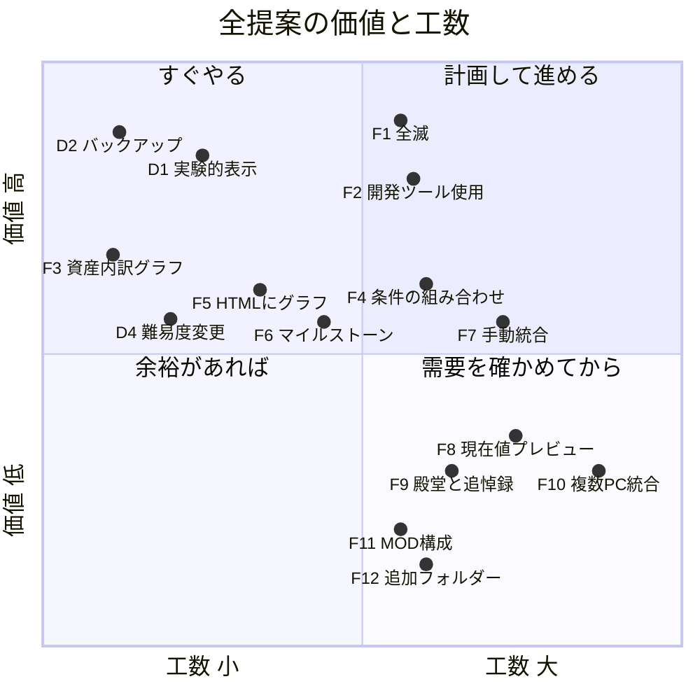

# 追加機能・改善・設計不備の提案（2026-11-24、main `c4f13f8`）

最初に手を付けるべきは、記録を守る自動バックアップ（D2）と、実装済み488項目のうち416項目に付いている「実験的」表示の見直し（D1）です。どちらも工数が小さく、利用者の信頼に直結します。新機能では、通算統計に欠けている「全滅」と「開発者モードの使用」の記録（F1・F2）が最も価値が高いと判断しました。

この文書は提案だけで、コードは変更していません。

## 前提

- 調べた対象は main `c4f13f8`（v2.0.0、#399、#414 の一括修正まで）です。
- この版はビルドで警告0・エラー0でした。Core テストは 2,236 件中、失敗0・スキップ14です。スキップはすべて、手元の実セーブが必要なテストです。
- GitHub の未解決 Issue は 0 件です。
- ゲーム本体の挙動は、R2 の監査済み索引（`research/vanilla-1.7.4985-audited/`、1.7.4985 rev1269）で確かめました。実セーブ（1.7.5005）は project files の6件を読み取りだけで照合しました。
- 実ゲームの起動と画面の確認はしていません。UI の見え方とフレーム時間に関する主張はありません。
- 過去の決定（V2-E の不採用、#399 と2回目の性能調査、#400〜#414 の監査）は、プロジェクトのメモリと文書で確かめてから除外しました。

| 目盛り | 意味 |
| --- | --- |
| 優先度 | 高：利用者の不利益か信頼に直結し、費用が小さい。中：価値は明確だが急がない。低：一部の利用者向け |
| 工数 | S：1 PR・小規模。M：1〜2 PR、UI と12言語の訳とテストを含む。L：設計書と複数の PR が必要 |
| リスク | 既存の記録や集計を壊す可能性、ゲーム更新で壊れる可能性 |
| 確認度 | 確認済み：コード、ゲーム索引、実セーブで直接確かめた。推定：読んだ範囲からの推論で、未検証 |

## 要約

| 順 | 項目 | 種類 | 優先度 | 工数 | リスク | 理由（一行） |
| --- | --- | --- | --- | --- | --- | --- |
| 1 | D2 自動バックアップが数回のセーブで入れ替わる | 不備 | 高 | S | 低 | 取り戻せない通算記録の、長期の戻り先がない |
| 2 | D1 「実験的」が85%の項目に付く | 不備 | 高 | S〜M | 低 | 表示が意味を失い、README の説明とも食い違う |
| 3 | F1 全滅（ゲームオーバー）の記録 | 機能 | 高 | M | 低〜中 | コロニーの終わり方の半分が記録されていない |
| 4 | F2 開発者モード・デバッグ操作の使用記録 | 機能 | 高 | M | 低〜中 | 今はエンディング時点の1ビットしかない（D5） |
| 5 | F3 資産内訳と囚人数の履歴グラフ | 機能 | 中 | S | 低 | 読み込み済みのデータを粗く描いているだけ |
| 6 | D4 難易度などが最も進んだセーブの値だけ | 不備 | 中 | S | 低 | 途中変更が見えず、絞り込みも最後の値で判定 |
| 7 | F4 スマートグループの条件の組み合わせ | 機能 | 中 | M | 低 | F1・F2 の結果を絞り込みに使えるようになる |

全提案を価値と工数で並べると次のとおりです（位置は筆者の見積もりで、計測値ではありません）。

## 設計上の不備

5件はすべてコードで確認済みです。どれも記録された値を壊してはいません。ただし、表示の意味やデータの守り方が実態と合っていません。

### D1 「実験的」が実装済み項目の85%に付き、意味を失っている

- **問題**：取得単位は全部 `Unverified` です（[AcquisitionUnits.cs:41-101](../../Source/RimworldStatistics.Core/Stats/AcquisitionUnits.cs#L41-L101)）。表示は「取得単位ありかつ未公開」を実験的と判定します（[MetricRegistry.cs:152](../../Source/RimworldStatistics.Core/Stats/MetricRegistry.cs#L152)、[MetricStatus.cs:133-136](../../Source/RimworldStatistics.Core/Stats/MetricStatus.cs#L133-L136)）。その結果、実装済み488定義のうち416が実験的です。
- **数え方**：ビルド済み Core を読む小さなプログラムで数えました（`ImplementedCatalog` 488、取得単位あり 416、そのすべてが未公開）。取得単位なしの基本項目は72だけです。任意の MOD 連携単位（`mod.*`）は、導入 MOD によって増減します。
- **壊れにくいものまで対象**：セーブファイルを読むだけの入植者構成（33項目）や備蓄（16項目）にも、MOD 導入前セーブの読み取り結果にも、「実験的」の根拠が付きます（[SaveReader.Metrics.cs:131-220](../../Source/RimworldStatistics.Core/Reading/SaveReader.Metrics.cs#L131-L220)）。
- **文書との食い違い**：[AcquisitionUnits.cs:17](../../Source/RimworldStatistics.Core/Stats/AcquisitionUnits.cs#L17) は「未検証なら取得は閉じ、出力は非公開」、[MetricGates.cs:8-12](../../Source/RimworldStatistics/Metrics/MetricGates.cs#L8-L12) は「検証済みか検証用ハーネスが開いた単位だけ記録」と書いています。実際は既定で全単位を記録し（[MetricGates.cs:50-57](../../Source/RimworldStatistics/Metrics/MetricGates.cs#L50-L57) の `*`）、全定義を表示します（[Dialog_RimworldStatistics.cs:270-272](../../Source/RimworldStatistics/UI/Dialog_RimworldStatistics.cs#L270-L272)）。README（108行）は「対象MODの版や内部実装で取れないことがあるもの」と説明しています。
- **付随する罠**：公開済み72項目だけを作る既定の `BuildView(profile, colonies, stats)` が残っています（[MetricCalculator.cs:120-121](../../Source/RimworldStatistics.Core/Stats/MetricCalculator.cs#L120-L121)）。これを使うテストは、製品と異なる項目の集合を試している可能性があります（推定。各テストの意図は未確認）。
- **影響**：「実験的」フィルターや取得状況タブの件数が、実質「基本72項目以外」になっています。本当に壊れやすい、他 MOD の内部へのフックが埋もれます。
- **対策**：壊れやすさの実際の原因で定義し直します。他 MOD の内部メソッドに依存する単位と、実ゲームで一度も確認していない単位だけを実験的にします。#304 の実ゲーム検証ホストで確認した単位を `Verified` に上げる手順も決めます。コメントと README を実態に合わせ、既定の `BuildView` は削除するか製品と同じ集合にします。
- **工数・リスク**：S〜M（判定、12言語の説明文、テスト）。記録値は変えないので、リスクは低いです。

### D2 自動バックアップが数回のセーブで入れ替わり、長期の戻り先がない

- **問題**：`profile.json` の自動バックアップは bak1〜bak3 の3世代で、統計が変わる書き込みのたびに回ります（[ProfileStore.cs:327-356](../../Source/RimworldStatistics.Core/Profiles/ProfileStore.cs#L327-L356)、[468-473](../../Source/RimworldStatistics.Core/Profiles/ProfileStore.cs#L468-L473)）。ゲームのセーブのたびにこの書き込みが起きます（[GameComponent_RimworldStatistics.cs:235](../../Source/RimworldStatistics/GameComponent_RimworldStatistics.cs#L235)）。ZIP バックアップの呼び出しは、「データ管理」タブの手動操作だけです（[DataManagementTab.cs:76](../../Source/RimworldStatistics/UI/DataManagementTab.cs#L76)）。
- **影響**：ファイルの破損には強い仕組みです。しかし、不具合のある版や誤った操作で誤った内容が書かれると、オートセーブ3回ほどで全世代に行き渡ります。元のセーブを消した後は、取り込み直しもできません。記録ファイルには書いた MOD の版も残らず（[Profile.cs:44-57](../../Source/RimworldStatistics.Core/Model/Profile.cs#L44-L57)）、更新の前後を区別できません。
- **対策**：新しい MOD の版で最初に書き込む前に、ZIP を自動で作ります。加えて、実時間で週に1回などの定期 ZIP を件数の上限つきで残します。既存の `ProfileService.CreateBackup` をそのまま使えます。
- **工数・リスク**：S、低。大きな記録ファイルでの容量と作成時間は未計測です。

### D3 手動の統合・分割はデータの形だけあり、操作する手段がない

- **問題**：手動統合（`ManualMerges`）は照合の最後に適用されますが（[CampaignMatcher.cs:42](../../Source/RimworldStatistics.Core/Matching/CampaignMatcher.cs#L42)、[347](../../Source/RimworldStatistics.Core/Matching/CampaignMatcher.cs#L347)）、書き込む画面も処理もありません（`Source/` 全体で書き込み箇所がないことを確認）。手動分割（`ManualSplits`）は保存されるだけで適用されません（[Profile.cs:12-13](../../Source/RimworldStatistics.Core/Model/Profile.cs#L12-L13)）。設計書 §7.4・§13 の「操作画面は後の段階」のままです。
- **影響**：自動照合が誤って分けた、またはまとめたコロニーを、利用者が直せません。問題の報告を受けても、案内できる手段がありません。
- **対策**：F7 の画面を作るか、使わないなら形を削除します。作るなら、適用処理が既にある統合を先にします。

### D4 難易度・ストーリーテラーは最も進んだセーブの値だけで決まり、途中の変更が見えない

- **問題**：コロニーのシナリオ・ストーリーテラー・難易度・パーマデスは、最も進んだ観測1件の表示情報で決まります（[StatsCalculator.cs:147-196](../../Source/RimworldStatistics.Core/Stats/StatsCalculator.cs#L147-L196)）。各セーブの観測には難易度が保存されています（[SaveReader.cs:416-420](../../Source/RimworldStatistics.Core/Reading/SaveReader.cs#L416-L420)）。スマートグループの難易度判定も最後の値です（[SmartGroup.cs:141-142](../../Source/RimworldStatistics.Core/Stats/SmartGroup.cs#L141-L142)）。
- **影響**：「過酷で始めて途中で下げた」コロニーが、最後の難易度のグループと難易度別ランキングにだけ入ります。
- **対策**：観測から変遷を集め、コロニー一覧と総括レポートに「途中変更あり（例：過酷→荒野）」を出します。スマートグループに「開始時の難易度」「一度も下げていない」を加えます。
- **工数・リスク**：S、低。カスタム難易度の中身（脅威の倍率など）がセーブにどう残るかは未確認です。今回の実セーブは非カスタムで、`<difficulty>Hard</difficulty>` だけが残っていました。

### D5 開発者モードの記録がエンディングの瞬間の1ビットだけ

- **問題**：記録されるのは、エンディングを記録した瞬間の `Prefs.DevMode` だけです（[EndingPatches.cs:34](../../Source/RimworldStatistics/Patches/EndingPatches.cs#L34)、[EndingEvent.cs:20](../../Source/RimworldStatistics.Core/Model/EndingEvent.cs#L20)）。設定「開発者モード中に記録したエンディングを表示」も、これで判定します。
- **影響**：プレイ中に開発者モードやデバッグ操作を使い、エンディングの前に切ったコロニーを区別できません。設定名が約束することと、実際に判定できることがずれています。
- **対策**：F2 で継続的に記録します。

## 追加機能の提案

12件を価値の高い順に並べました。DLC や対応 MOD の個別の統計は、既存の台帳（`docs/planned-mod-statistics/`）に整理済みなので、ここでは扱いません。

### F1 全滅（ゲームオーバー）の記録（優先度 高・M・リスク 低〜中）

- **内容**：入植者が全員いなくなった日、そこまでの日数、新しい放浪者で続けたかを記録します。ランキング（全滅までの日数）、年表、スマートグループ（全滅した／していない）に使います。
- **現状**：エンディングの種類に全滅はなく（[Enums.cs:4-15](../../Source/RimworldStatistics.Core/Model/Enums.cs#L4-L15)）、設計書と候補台帳にもありません。通算統計でありながら、コロニーの終わり方の半分が記録されていません。
- **実現性（索引で確認）**：`RimWorld.GameEnder.CheckOrUpdateGameOver` が全滅を判定し、400 tick の秒読みを始めます。宇宙船の秒読み、グラヴシップの移動中、アノマリーの死の拒絶は、本体が自分で除外しています。`GameEndTick` が「GameOver」の手紙を送り、その後に新しい放浪者を作る選択肢を出します。この手紙を送る瞬間を捉えれば、判定を自前で作らずに済みます。
- **導入前セーブ**：`gameEnder` の `newWanderersCreatedTick`（既定 -99999）はセーブに残ります。既定以外なら「少なくとも1回全滅し、新しい放浪者で続けた」と言えます。実セーブでは、既定値のみの場合に `<gameEnder />` となることを確認しました。この値を書き込む処理は未確認です。
- **設計の注意**：エンディングとは別の記録にします。混ぜると「エンディング到達済み」のグループやランキングが歪みます。二重計上を防ぐため、エンディングと同じく、セーブ系統の中の回数で重複を除きます。`GameEndTick` が毎 tick 呼ばれるかは未確認のため、フックはフィールドの比較だけで早期に戻します。

### F2 開発者モード・デバッグ操作の使用記録（優先度 高・M・リスク 低〜中）

- **内容**：開発者モードを有効にしていた時間、実行したデバッグ操作の回数、ゴッドモードの使用を、コロニーごとに記録します。「開発ツール未使用（記録開始以降）」を絞り込みやランキングに使えます。D5 の解消です。
- **実現性（索引で確認）**：デバッグ操作の実行は `LudeonTK.DebugActionNode.Enter(Dialog_Debug)`、デバッグツールは `LudeonTK.DebugTools.curTool`、ゴッドモードは `Verse.DebugSettings.godMode` で捉えられます。既存のチェックポイントの記録方式に載せれば、ロードし直しや分岐でも正しい系統に紐づきます。
- **限界**：`Verse.GameInfo` に開発者モードの記録はありません（確認済み）。`DebugSettings` は静的な値なので、セーブにも残らないと推定します。したがって導入前や記録開始前の期間は「不明」であり、「未使用」とは表示しません。

### F3 資産内訳と囚人数の履歴グラフを高解像度にする（優先度 中・S・リスク 低）

- **現状**：セーブ内のゲームの記録（0.5日刻み）のうち、物品・建物・生物の資産と囚人数も読み込んでいます（[HistoryMetricReader.cs:24-39](../../Source/RimworldStatistics.Core/Reading/HistoryMetricReader.cs#L24-L39)）。しかしグラフでこの記録を使うのは、総資産・入植者数・気分・脅威・適応だけです（[MetricCalculator.ChartHistory.cs:70-78](../../Source/RimworldStatistics.Core/Stats/MetricCalculator.ChartHistory.cs#L70-L78)）。他はセーブ1件につき1点で描かれます。
- **内容**：対応表に4系列を加え、資産を物品・建物・生物の積み上げで見る表示も作ります。MOD 導入前セーブにも効きます。

### F4 スマートグループの条件の組み合わせと新しい条件（優先度 中・M・リスク 低）

- **現状**：条件は8種類で、一度に1つだけです（[SmartGroup.cs:4-14](../../Source/RimworldStatistics.Core/Stats/SmartGroup.cs#L4-L14)）。「パーマデスかつ過酷」は作れません。
- **内容**：条件の AND を許します。新しい条件は、既に保存済みのデータで作れるものから始めます。有効 DLC の組み合わせ（`ActiveDlcIds`）、ゲームの版（`GameVersions`）、MOD 構成が同じ（`ModSetHash`、[SaveReader.Metrics.cs:80-87](../../Source/RimworldStatistics.Core/Reading/SaveReader.Metrics.cs#L80-L87)）です。F1・F2・D4 の結果（全滅、開発ツール未使用、難易度を下げていない）も加えます。
- **注意**：保存形式を変えるため、古い版で開いたときに条件が消えないようにします。

### F5 総括 HTML レポートにグラフを埋め込む（優先度 中・S〜M・リスク 低）

- **現状**：HTML 出力には図がありません（[ColonyReportHtmlExport.cs](../../Source/RimworldStatistics.Core/Export/ColonyReportHtmlExport.cs) に SVG の出力なし）。
- **内容**：資産・人口・気分の推移を、外部ファイルに依存しない埋め込み SVG で出します。系統を証明できない点は、画面と同じく線で結びません。Core だけで作れ、テストしやすい部分です。

### F6 コロニー内のマイルストーン到達日（優先度 中・S〜M・リスク 低）

- **内容**：「資産が10万・100万を初めて超えた日」「入植者が10人になった日」を、ゲームの記録から求めます。コロニー間で到達の速さをランキングでき、年表にも並べられます。MOD 導入前セーブにも効きます。
- **V2-E との違い**：V2-E は実時間の順序が信頼できないため不採用でした。こちらは1つのコロニーの中のゲーム内 tick だけを比べるので、その問題は起きません。ただし到達日の粒度は0.5日です。

### F7 手動の統合・分割の操作画面（優先度 中・M・リスク 中）

- **内容**：D3 の解消です。「コロニー」タブから2つのコロニーを統合し、元に戻せるようにします。
- **リスク**：照合は取り込みの順序に依存しない前提です（設計書 §7.4）。手動統合と自動の照合、分岐、エンディングの重複除去の関係を、先に設計する必要があります。分割は「何を単位に分けるか」が未決です。

### F8 プレイ中の「現在値」プレビュー（優先度 中〜低・M〜L・リスク 中）

- **現状**：プレイ中の値は、セーブ時（[GameComponent_RimworldStatistics.cs:239](../../Source/RimworldStatistics/GameComponent_RimworldStatistics.cs#L239)）とエンディング時（[EndingPatches.cs:52](../../Source/RimworldStatistics/Patches/EndingPatches.cs#L52)）にだけ記録に入ります。画面はゲームの現在の状態を読みません。つまり「現在のコロニーの統計」は、最後のセーブ時点の値です。
- **内容**：画面を開いたときだけ、セーブ時と同じ読み取り（`SavedStateMetricReader.Read`）と記録中のカウンターを保存せずに重ね、「未保存」と分かる表示にします。
- **優先度が低めな理由**：遅れはオートセーブの間隔ぶんだけです。表示を作る仕組みが記録ファイル前提なので、一時的な観測を混ぜる改修は大きくなります。

### F9 入植者の殿堂と追悼録（優先度 低〜中・M・リスク 中）

- **内容**：入植者ごとの記録（撃破数、在籍日数など）の上位と、亡くなった入植者の名簿（日・死因）を残します。設計書 §13 で「入植者ごとの記録」は後の段階とされ、まだありません。
- **実現性**：プレイ中は、セーブ時に生きた値を読めます。導入前セーブの `<records><vals>` は定義の順番だけで並んでいる（実セーブで確認）ため、MOD 構成が変わると読み違える恐れがあります（推定）。プレイ中の記録に限るのが安全です。
- **注意**：名前を保存するため、匿名診断と公開用の出力からは必ず除きます。記録は上位N件に限り、増え方を抑えます。

### F10 複数の PC の記録を統合する（優先度 低〜中・L・リスク 高）

- **現状**：復元は記録ファイルを丸ごと置き換えます（[ProfileRestore.cs:12](../../Source/RimworldStatistics.Core/Backup/ProfileRestore.cs#L12)）。設計書 §13 で「複数の PC での同期」は範囲外とされています。
- **内容**：別の PC のバックアップ ZIP を「統合して取り込む」操作を加えます。
- **リスク**：エンディングの重複除去、コロニーの判定キーの台帳、チェックポイントの保管、利用者の判断（除外など）の衝突をすべて決める必要があります。設計書から始める大きな作業です。利用者が実際に複数の PC で遊ぶかを、先に確かめるべきです。

### F11 MOD 構成の記録と差分表示（優先度 低・M・リスク 低〜中）

- **現状**：セーブから MOD の一覧を読みますが、保存するのは件数（[SaveObservation.cs:17](../../Source/RimworldStatistics.Core/Model/SaveObservation.cs#L17)）とハッシュ、有効 DLC だけです。
- **内容**：MOD のパッケージ ID の一覧を重複なしの表で保存し、コロニー間・セーブ間の差分を表示します。「MOD X を入れていたコロニー」での絞り込みにも使えます。容量の増え方は未計測です。

### F12 追加のセーブフォルダーの取り込み（優先度 低・M・リスク 中）

- **現状**：取り込みは Saves フォルダー直下だけです（[ImportEngine.cs:114](../../Source/RimworldStatistics.Core/Import/ImportEngine.cs#L114)）。これは本体のセーブ一覧と同じ範囲です。RimSaves の「フォルダー」も、ファイル名に区切りを入れる方式で直下に置かれます（RimSaves 1.6 版のソースで確認）。
- **内容**：別の場所に退避した古いセーブを読めるようにします。セーブの識別にフォルダーを含める変更が要り、既存の記録との互換に注意が要ります。当てはまる利用者は少ないと推定します。

## 小さな改善と文書の不一致

| 項目 | 根拠 | 優先度・工数 |
| --- | --- | --- |
| README のスマートグループの説明に、難易度別・シナリオ別・「リロード可のみ」がない（日本語・英語とも） | [README.md:24](../../README.md)、[SmartScopeUi.cs:64-107](../../Source/RimworldStatistics/UI/SmartScopeUi.cs#L64-L107) | 低・S |
| 取得単位と取得ゲートのコメントが、既定で全部記録する現状と逆のことを書いている | D1 を参照 | D1 と同時に直す |
| エンディング時の旅立った人数（`ending_party`）は、利用者が取得を全部切っても記録される。取得単位の一覧には載るが、ON/OFF の対象外 | [MetricGates.cs:71](../../Source/RimworldStatistics/Metrics/MetricGates.cs#L71)、[CreditsContext.cs:60](../../Source/RimworldStatistics.Core/Endings/CreditsContext.cs#L60) | 低・S（説明を足すだけでよい） |
| 記録ファイルが 256 MB を超えると、その起動では読み取り専用になり、古いバックアップへ落ちる。利用者への案内はない。実際にこの大きさに届くかは未計測 | [ProfileStore.cs:103-107](../../Source/RimworldStatistics.Core/Profiles/ProfileStore.cs#L103-L107)、[180-186](../../Source/RimworldStatistics.Core/Profiles/ProfileStore.cs#L180-L186) | 低（推定）・S |

## 調べて問題なしと判断したもの

後の調査で同じことを繰り返さないために残します。

- **取り込みが Saves 直下だけ**：本体のセーブ一覧と同じ範囲で、RimSaves のフォルダーも直下にあります。不具合ではありません（F12 は機能の提案）。
- **変更のたびに表示用キャッシュを全部捨てる**：記録の変更は、ゲームの開始・ロード・セーブ、エンディング、除外の切り替えと、取り込み中のまとめ書きに限られます。プレイ中に高い頻度で起きる変更はなく、問題になる頻度ではありません。
- **ゲームスレッドの待ち**：セーブ時の記録は待たずに積み、表示の構築は中断できます（[ProfileSession.cs:290-316](../../Source/RimworldStatistics.Core/Profiles/ProfileSession.cs#L290-L316)、`PreemptCancellableViews`）。
- **揺らぎのあったメモリ割り当てテスト**：ウォームアップが追加済みです（[NumericSaveReaderTests.cs:317](../../Tests/RimworldStatistics.Core.Tests/Core/Reading/NumericSaveReaderTests.cs#L317)）。
- **系統の「issue 4」**（親が欠けると、それ以前のチェックポイント履歴が消える）：以前の点も描くようになっています（[MetricCalculator.ChartHistory.cs:333-355](../../Source/RimworldStatistics.Core/Stats/MetricCalculator.ChartHistory.cs#L333-L355)）。コードを読んだだけで、実セーブでは確かめていません。
- **#414 の自動取り込みのゲート**：差分を読み、後退は見つかりませんでした。
- **2026-11-18 のロードマップの DLC 統計**：ゼノタイプ別、ボス、遺伝子抽出、奴隷化、改革回数などの多くは実装済みです。

### 過去の決定との関係

- **V2-E（通算の自己ベスト更新履歴）**：再提案しません。不採用の理由（実時間の順序が信頼できない、比較できる完全な前回値がない）は今も変わりません。F6 は1つのコロニーの中の tick だけを比べるので別物です。
- **性能**：#399 と2回目の調査の結論を変える材料はありません。文字列の切り詰めのキャッシュは、実ゲームのフレーム時間を測るまで提案しません。ReadyToRun も、WaylithClr での受け入れが未確認のままなので提案しません。
- **MOD 対応の拡大**：既存の台帳（`docs/planned-mod-statistics/`）に従い、この文書では重ねて扱いません。

## 推奨の進め方

1. D2 の自動バックアップ（S）。以降の作業の安全網になるので最初にします。
2. D1 の「実験的」の再定義（S〜M）。
3. F3 と D4（どちらも S）。既存のデータで済み、すぐ見える改善です。
4. F1 の全滅の記録（M）。
5. F2 の開発ツール使用の記録（M）。
6. F4 のスマートグループの組み合わせ（M）。F1・F2・D4 の結果を条件に使います。
7. F5 と F6。
8. F7 は設計書を先に作ります。F8〜F12 は利用者の需要を確かめてからにします。

### 未確認の事項

- 実ゲームでの動作は確かめていません。F1・F2 のフック先は 1.7.4985 の索引で確認したものです。実装の前に、R2 の Game-Windows（1.7.5011）で署名を確かめ直します。
- 索引の Def は Core・Royalty・Ideology・Biotech・Odyssey の5つで、Anomaly の Def はありません。F1 が頼るアノマリー関連の判定は DLL 側の本体処理なので、影響はないと考えます（推定）。
- `newWanderersCreatedTick` を書き込む処理、`GameEndTick` の呼び出し頻度、カスタム難易度の保存形式は未確認です。
- D2 のバックアップの容量と作成時間は未計測です。
- 「実験的」の件数は、ビルド済み Core の定義で数えたものです。
